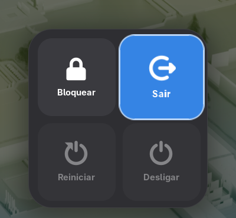
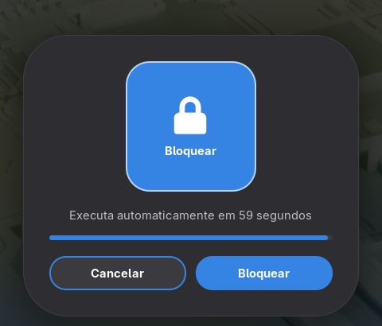
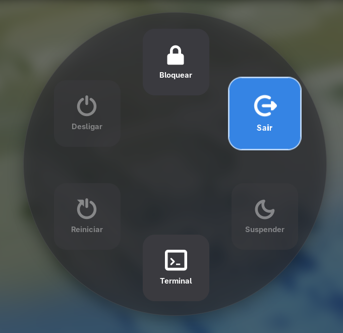
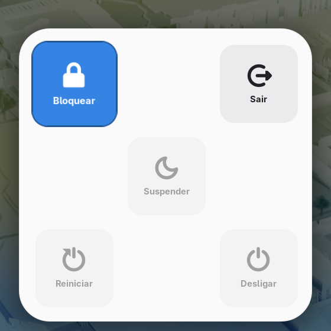
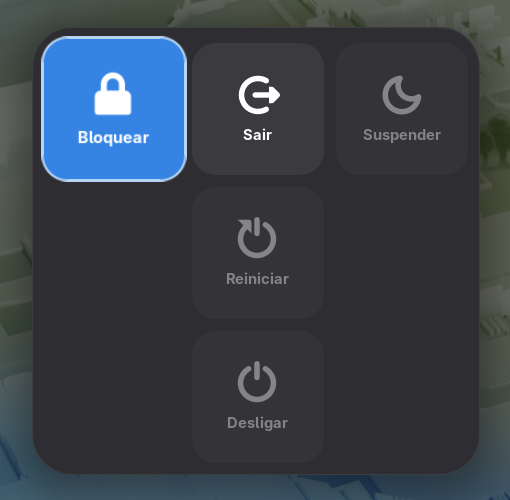
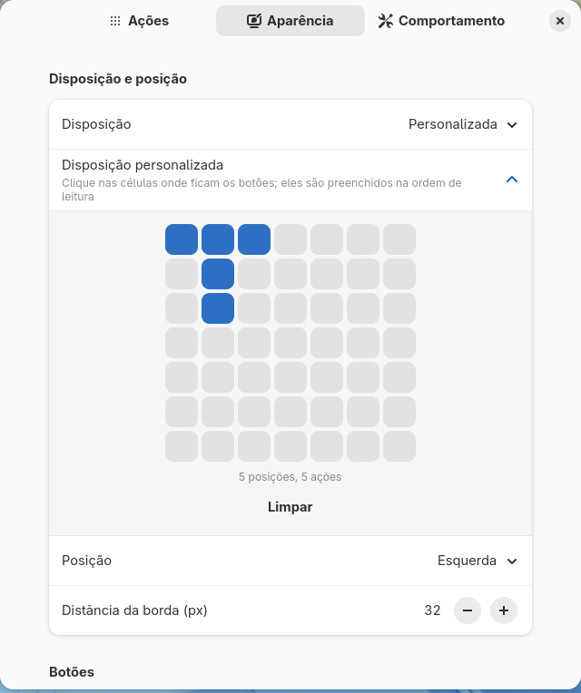

# Fast GNOME Menu

Extensão para o GNOME Shell que abre um menu de energia interativo, no estilo do [wlogout](https://github.com/ArtsyMacaw/wlogout): botões com cantos arredondados para bloquear a tela, sair da sessão, suspender, hibernar, trocar de usuário, reiniciar, desligar ou rodar comandos seus.

O menu é usado pelo teclado (setas ou teclas de atalho) ou pelo mouse, pode ficar no centro, numa borda ou num canto da tela, e segue o tema claro/escuro, a cor de destaque e o idioma do sistema.

| Menu padrão | Confirmação | Circunferência com desfoque |
|---|---|---|
|  |  |  |

| Tema claro, 5 ações | Disposição personalizada | Preferências |
|---|---|---|
|  |  |  |

As capturas são geradas pelo [teste automático](#teste-automático-buildsh-test).

## Sumário

- [Recursos](#recursos)
- [Pré-requisitos](#pré-requisitos)
- [Instalação](#instalação)
- [Como usar](#como-usar)
- [Configurações](#configurações)
- [Como funciona](#como-funciona)
- [Estrutura do projeto](#estrutura-do-projeto)
- [Compilação e empacotamento](#compilação-e-empacotamento)
- [Testes](#testes)
- [Desenvolvimento e depuração](#desenvolvimento-e-depuração)
- [Traduções](#traduções)
- [Estado do projeto](#estado-do-projeto)
- [Ideias para o futuro](#ideias-para-o-futuro)

## Recursos

- **Ações nativas:** Bloquear, Sair, Suspender, Hibernar, Trocar usuário, Reiniciar e Desligar. As quatro ativadas por padrão são Bloquear, Sair, Reiniciar e Desligar.
- **Ações personalizadas:** qualquer comando, com nome e ícone próprios (abrir um terminal, desligar o monitor, reiniciar no firmware…). O comando roda **sem shell**, então não há injeção de comandos.
- **Disposições:**
  - **Automática:** 1 a 3 em linha, 4 em 2×2, 5 como a face de um dado, 6 em 2×3;
  - **Grade** com número fixo de colunas, **Linha** e **Coluna**;
  - **Circunferência** e **Círculo com centro**, com painel redondo;
  - **Personalizada**, desenhada clicando numa grade 7×7 nas preferências.
- **Posição:** centro, as quatro bordas ou os quatro cantos, com distância da borda ajustável. Se o menu não couber na tela, ele encolhe para caber.
- **Fundo:** escurecimento e desfoque da tela atrás do menu; painel sólido, translúcido (vidro fosco, junto com o desfoque) ou invisível.
- **Destaque:** o botão selecionado usa a cor de destaque do sistema, ou uma cor sua, e cresce com uma animação suave.
- **Confirmação opcional** para nenhuma ação, todas ou só as escolhidas, com:
  - o botão da ação;
  - uma contagem regressiva (60 s por padrão) com barra de progresso;
  - os botões Cancelar e Confirmar, com Cancelar focado por padrão.
- **Tema e idioma:** folhas de estilo para os temas claro e escuro, trocadas automaticamente; traduções para português do Brasil e espanhol.
- **HiDPI:** funciona com escala de interface 2× e maiores.
- **Leve:** nada roda em segundo plano. O menu é montado só quando abre e destruído quando fecha.
- **Preferências em três abas:** Ações, Aparência e Comportamento.

## Pré-requisitos

### Para usar e compilar

| Pacote (Fedora) | Versão | Fornece | Para quê |
|---|---|---|---|
| `gnome-shell` | 48, 49 ou 50 | GNOME Shell e o comando `gnome-extensions` | Rodar a extensão, ativá-la e gerar o `.zip` |
| `gjs` | a que acompanha o GNOME | Interpretador JavaScript do GNOME | Rodar a extensão, as preferências e os testes unitários |
| `glib2` | qualquer recente | `glib-compile-schemas` | Compilar o schema de configurações |
| `gettext` | qualquer recente | `msgfmt`, `xgettext`, `msgmerge` | Compilar e atualizar as traduções |

`gnome-shell` e `gjs` já vêm com qualquer instalação do GNOME. Os scripts precisam do `bash`.

### Para testar e desenvolver

| Pacote (Fedora) | Fornece | Usado por |
|---|---|---|
| `dbus-daemon` | `dbus-run-session` | `./build.sh test` e `./build.sh dev`: dão ao GNOME Shell de teste um barramento D-Bus próprio |
| `dbus-tools` | `dbus-update-activation-environment` | `./build.sh test`: escolhe a aba das preferências nas capturas |
| `mutter-devkit` | janela que hospeda a sessão aninhada | `./build.sh dev` (GNOME 49+). No GNOME 48, a sessão usa `--nested` e não precisa dele |

O Fedora não instala o `dbus-daemon` por padrão porque usa o `dbus-broker` no sistema. Os dois convivem sem problema: o `dbus-daemon` só roda quando o `dbus-run-session` o chama.

### Resumo por comando

| Comando | Precisa de |
|---|---|
| `./build.sh`, `install`, `stage`, `pack`, `pot`, `prefs` | `gnome-shell`, `gjs`, `glib2`, `gettext` |
| `./build.sh unit` | `gjs` |
| `./build.sh test` | os do primeiro item, mais `dbus-daemon` e `dbus-tools` |
| `./build.sh dev` | os do primeiro item, mais `dbus-daemon` e `mutter-devkit` |

No Fedora, tudo de uma vez:

```sh
sudo dnf install gnome-shell gjs glib2 gettext dbus-daemon dbus-tools mutter-devkit
```

No Debian/Ubuntu, para usar, compilar e rodar os testes unitários (os nomes dos pacotes da sessão aninhada variam entre versões):

```sh
sudo apt install gnome-shell gjs libglib2.0-bin gettext
```

## Instalação

### A partir do código-fonte

```sh
git clone https://github.com/wvmj-dev/fast-gnome-menu.git
cd fast-gnome-menu
./build.sh install
```

O comando compila o schema e as traduções e copia a extensão para `~/.local/share/gnome-shell/extensions/fast-gnome-menu@wvmj-dev.github.io`.

Depois disso:

1. **Saia e entre de novo na sessão.** No Wayland, o GNOME Shell só carrega extensões novas, ou o código novo de uma extensão, num novo login.
2. Ative a extensão:

   ```sh
   gnome-extensions enable fast-gnome-menu@wvmj-dev.github.io
   ```

   Ou use o aplicativo **Extensões**.

### A partir do `.zip`

```sh
./build.sh pack
gnome-extensions install --force fast-gnome-menu@wvmj-dev.github.io.shell-extension.zip
```

Em seguida, siga os passos 1 e 2 acima.

### Desinstalação

```sh
gnome-extensions uninstall fast-gnome-menu@wvmj-dev.github.io
```

## Como usar

Abra o menu com **`Super+X`** (atalho padrão) ou pelo ícone de energia na barra superior, com clique, toque ou `Enter` na navegação por teclado da barra.

| Tecla | Efeito |
|---|---|
| `←` `→` `↑` `↓` | Vai para o botão vizinho naquela direção. No fim de uma linha ou coluna, volta para o outro extremo |
| `Tab` / `Shift+Tab` | Próximo / anterior, na ordem das ações |
| `Enter` / `Espaço` | Executa a ação selecionada (ou abre a confirmação dela) |
| `1` … `9` | Executa a ação naquela posição (ou abre a confirmação dela) |
| Letra da ação | Executa a ação diretamente (tabela abaixo), ou abre a confirmação dela |
| `Esc`, o atalho de abrir ou clique fora do painel | Fecha o menu (o clique fora pode ser desligado) |

| Ação | Letra | Ícone |
|---|---|---|
| Bloquear | `L` | `system-lock-screen-symbolic` |
| Sair | `E` | `system-log-out-symbolic` |
| Suspender | `S` | `weather-clear-night-symbolic` |
| Hibernar | `H` | `drive-harddisk-symbolic` |
| Trocar usuário | `U` | `system-switch-user-symbolic` |
| Reiniciar | `R` | `system-reboot-symbolic` |
| Desligar | `P` | `system-shutdown-symbolic` |

As letras são fixas, para não mudarem quando o idioma do sistema muda, e não aparecem nos botões. Ações personalizadas não têm letra, mas podem ser acionadas pelo número da posição. Passar o mouse sobre um botão também o seleciona.

Uma ação que o sistema não permite no momento (por exemplo, bloquear a tela desativado por política, ou hibernar sem swap) aparece esmaecida, e a seleção pula por cima dela.

### Na tela de confirmação

| Tecla | Efeito |
|---|---|
| `Enter` / `Espaço` | Aciona o botão em foco. Ao abrir, o foco está em Cancelar (configurável), para que um `Enter` a mais não execute a ação |
| `←` `→` / `Tab` | Alterna entre Cancelar e Confirmar |
| `Esc` ou clique fora do painel | Cancela e volta ao menu, com a mesma ação selecionada |

Quando a contagem chega a zero, a ação é executada sozinha, como na janela de desligamento do GNOME.

## Configurações

Abra as preferências pelo aplicativo **Extensões** ou com:

```sh
gnome-extensions prefs fast-gnome-menu@wvmj-dev.github.io
```

As alterações valem a partir da próxima vez que o menu for aberto.

**Aba Ações**
- quais ações aparecem e em que ordem;
- ações personalizadas: adicionar, editar e excluir.

**Aba Aparência**
- disposição, colunas da grade e desenho da disposição personalizada;
- posição e distância da borda;
- tamanho dos botões, cantos, espaçamento, tamanho do ícone e quanto o botão selecionado cresce;
- rótulos e cor de destaque própria;
- estilo do painel, escurecimento e desfoque da tela.

**Aba Comportamento**
- atalho e ícone na barra;
- monitor onde abrir;
- ação selecionada ao abrir;
- fechar ao clicar fora;
- confirmação: quais ações, duração da contagem e botão focado;
- restaurar todos os padrões.

| Chave GSettings | Tipo | Padrão | Descrição |
|---|---|---|---|
| `actions` | `as` | `['lock-screen', 'logout', 'restart', 'power-off']` | Ações exibidas, na ordem |
| `custom-actions` | `a(ssss)` | `[]` | Ações personalizadas: `(id, nome, ícone, comando)`. O id começa com `custom-` |
| `layout` | `s` | `'auto'` | `'auto'`, `'grid'`, `'row'`, `'column'`, `'circle'`, `'circle-center'` ou `'custom'` |
| `columns` | `i` (1–6) | `4` | Botões por linha, na grade |
| `custom-layout` | `as` | `['x.x', '.x.', 'x.x']` | Desenho da disposição personalizada: uma string por linha, cada `x` é uma posição |
| `position` | `s` | `'center'` | `'center'`, `'top'`, `'bottom'`, `'left'`, `'right'`, `'top-left'`, `'top-right'`, `'bottom-left'` ou `'bottom-right'` |
| `position-margin` | `i` (0–400) | `32` | Distância da borda, em pixels, fora do centro |
| `button-size` | `i` (64–256) | `128` | Tamanho dos botões, em pixels |
| `corner-radius` | `i` (0–64) | `24` | Raio dos cantos, em pixels (metade do tamanho deixa o botão redondo) |
| `spacing` | `i` (0–64) | `16` | Espaço entre os botões, em pixels |
| `icon-size` | `i` (20–70) | `34` | Tamanho do ícone, em % do botão |
| `focus-scale` | `i` (100–130) | `110` | Tamanho do botão selecionado, em %; `100` desliga o aumento |
| `show-labels` | `b` | `true` | Mostra o nome da ação sob o ícone |
| `highlight-color` | `s` | `''` | Cor de destaque `#rrggbb`; vazio usa a cor de destaque do sistema |
| `panel-style` | `s` | `'solid'` | `'solid'`, `'translucent'` ou `'none'` (os botões flutuam; a confirmação continua com fundo) |
| `backdrop-opacity` | `i` (0–100) | `50` | Escurecimento da tela, em % |
| `backdrop-blur` | `i` (0–60) | `0` | Raio do desfoque da tela; `0` desliga |
| `toggle-menu` | `as` | `['<Super>x']` | Atalho que abre/fecha o menu |
| `show-indicator` | `b` | `true` | Mostra o ícone na barra superior |
| `monitor` | `s` | `'pointer'` | `'pointer'` (monitor do ponteiro) ou `'primary'` (monitor principal) |
| `initial-focus` | `s` | `'first'` | Ação selecionada ao abrir: `'first'` ou `'last'` (a última usada, guardada em `last-action`) |
| `close-on-click-outside` | `b` | `true` | Fecha o menu ao clicar fora do painel |
| `confirm-mode` | `s` | `'none'` | Quais ações pedem confirmação: `'none'`, `'all'` ou `'custom'` (as de `confirm-list`) |
| `confirm-list` | `as` | `['logout', 'restart', 'power-off']` | Ações que pedem confirmação no modo `'custom'` |
| `confirm-timeout` | `i` (5–300) | `60` | Segundos até a confirmação executar a ação sozinha |
| `confirm-default` | `s` | `'cancel'` | Botão focado ao abrir a confirmação: `'cancel'` ou `'confirm'` |

Identificadores das ações nativas: `lock-screen`, `logout`, `suspend`, `hibernate`, `switch-user`, `restart` e `power-off`.

As chaves também podem ser alteradas pelo terminal:

```sh
SCHEMA=org.gnome.shell.extensions.fast-gnome-menu
DIR=~/.local/share/gnome-shell/extensions/fast-gnome-menu@wvmj-dev.github.io/schemas

gsettings --schemadir "$DIR" set $SCHEMA layout "'circle'"
gsettings --schemadir "$DIR" set $SCHEMA custom-actions "[('custom-term', 'Terminal', 'utilities-terminal-symbolic', 'gnome-terminal')]"
```

## Como funciona

### Abertura do menu

O atalho é registrado com `Main.wm.addKeybinding` e funciona na área de trabalho e no Panorama. Ele também funciona com o menu aberto, para poder fechá-lo, mas não abre o menu por cima de outro diálogo do sistema.

Ao abrir, a extensão:

1. cria uma camada do tamanho da tela inteira (`PowerMenu`), que escurece e, se configurado, desfoca o fundo, e recebe os cliques fora do painel;
2. calcula as posições dos botões pela disposição e, se o conjunto não couber na área útil do monitor, reduz tamanho, espaçamento e cantos;
3. posiciona o painel no monitor escolhido, conforme `position`;
4. chama `Main.pushModal`, que captura teclado e mouse até o menu fechar;
5. seleciona a primeira ação disponível (ou a última usada) e anima a entrada.

### Disposição dos botões

As posições são calculadas por `getCells()` em [layout.js](layout.js), em unidades de "um botão mais o espaçamento", e depois convertidas em pixels.

**Automática** (`'auto'`, padrão):

| Ações | Disposição |
|---|---|
| 1 | Só o botão |
| 2 ou 3 | Uma linha |
| 4 | Quadrado 2×2 |
| 5 | Como o de 4, com um no meio (face 5 de um dado ⚄) |
| 6 | Duas linhas de três (2×3) |
| 7 ou mais | Linhas de até ⌈√(1,5·n)⌉ botões, com a última linha centralizada |

```
1        2 ou 3        4          5              6

[■]      [■][■][■]     [■][■]     [■]    [■]     [■][■][■]
                       [■][■]        [■]         [■][■][■]
                                  [■]    [■]
```

No padrão de 5, os espaços no meio de cada lado ficam vazios: para que o botão do centro não se sobreponha aos cantos, eles precisam estar uma posição inteira afastados.

**Grade** (`'grid'`): linhas de `columns` botões; uma última linha mais curta fica centralizada. **Linha** e **Coluna** são grades com todos os botões numa só linha ou coluna.

**Circunferência** (`'circle'`): os botões ficam num anel, o primeiro no topo, em sentido horário. Dois botões quadrados vizinhos só não se sobrepõem a pelo menos √2 posições de distância, então o raio do anel é `√2/2 ÷ sen(π/n)` posições, com `n` botões.

**Círculo com centro** (`'circle-center'`): a primeira ação fica no meio e as demais no anel, com raio de pelo menos √2 para não encostar nos cantos do botão central. Nas duas disposições circulares, o painel é um círculo que alcança o canto mais distante de cada botão.

**Personalizada** (`'custom'`): cada `x` de `custom-layout` é uma posição, preenchida na ordem de leitura. Se houver mais ações do que posições, as que sobram continuam em linhas abaixo do desenho, com a largura dele.

### Posição, tamanho e escala

- **Área útil:** o menu fica dentro da área útil do monitor (`getWorkAreaForMonitor`), que exclui a barra superior.
- **Margem:** a distância da borda é aplicada como margem CSS. Margens definidas direto no ator seriam apagadas pelo St quando ele recalcula o estilo.
- **Confirmação:** abre na mesma posição do menu.
- **Encaixe:** se o painel não couber na área útil (botões grandes, monitor pequeno ou escalado), tamanho, espaçamento e cantos são reduzidos na mesma proporção **antes** de montar os botões.
- **Escala HiDPI:** o St multiplica as medidas em `px` do CSS pela escala da interface (`St.ThemeContext.scale_factor`), mas não os tamanhos e posições definidos por código. Por isso a geometria calculada em JavaScript é multiplicada pela escala, e o CSS fica em pixels lógicos.

### Navegação pelas setas

A navegação fica em `pickNeighbour()`, em [layout.js](layout.js), e usa a posição real de cada botão, por isso funciona em qualquer disposição. Entre os botões à frente na direção pressionada, ela escolhe o de menor `distância / √cos(ângulo)`:

- **Grade:** o vizinho em linha reta sempre ganha do diagonal.
- **Padrão de 5:** o botão do meio, na diagonal mas bem mais perto, ganha dos cantos. De um canto, `→` ou `↓` vai para o meio; do meio, a mesma seta continua para o canto do lado de onde você veio.
- **Botões desativados:** são pulados na mesma direção, como se fossem um espaço vazio. Assim eles não mudam o caminho.
- **Sem botão na direção:** a seleção volta para o outro extremo da mesma linha ou coluna.

### Destaque e tema

- **Foco:** o destaque usa o estado `:focus` do St. Passar o mouse sobre um botão também lhe dá o foco, então teclado e mouse compartilham o mesmo destaque.
- **Aparência do destaque:** o botão destacado recebe a cor de destaque e uma borda mais forte. Ele cresce até `focus-scale` com `ease()` (`EASE_OUT_BACK`, 200 ms) e fica por cima dos vizinhos.
- **Sem sombra:** no St, `box-shadow` com desfoque não acompanha os cantos arredondados e aparece como um quadrado borrado.
- **Temas:** as cores vêm de `stylesheet-dark.css` e `stylesheet-light.css`. O GNOME Shell carrega a variante do estilo atual e a recarrega quando ele muda. `stylesheet.css` é uma cópia da escura, usada se a variante não for encontrada.
- **Cor de destaque:** por padrão usa `-st-accent-color`. Com `highlight-color`, a cor é aplicada por estilo inline e o texto fica preto ou branco conforme a luminância. O valor só chega ao CSS se for exatamente `#rrggbb` ([color.js](color.js)), o que impede injetar CSS pela configuração.
- **Animações:** respeitam a opção global "Animações" do GNOME. Desligada, elas são instantâneas.

### Fundo

- **Desfoque:** usa `Shell.BlurEffect` no modo `BACKGROUND` na camada que cobre a tela, que desfoca o que está atrás enquanto o menu continua nítido. O escurecimento é desenhado por cima.
- **Custo:** o desfoque só existe enquanto o menu está aberto, mas o custo de GPU cresce com o raio, por isso vem desligado.
- **Sem desfoque só no painel:** o efeito do GNOME é retangular e apareceria como um quadrado borrado fora dos cantos arredondados. Painel translúcido mais desfoque da tela dá o mesmo resultado de vidro fosco.

### Confirmação

Se a ação pede confirmação (`confirm-mode` e `confirm-list`), o menu não fecha:

1. o painel de botões some, e uma camada preta extra escurece mais o fundo;
2. aparece um painel com:
   - o botão da ação, 25% maior;
   - o texto da contagem;
   - uma barra de progresso que esvazia de forma contínua;
   - os botões Cancelar e Confirmar;
3. ao chegar a zero, ou ao clicar em Confirmar, a ação é executada;
4. Cancelar, `Esc` ou um clique fora interrompem a contagem e trazem o menu de volta.

Só pode existir uma confirmação por vez. Enquanto ela está aberta, o menu que some não aceita cliques nem rouba o foco.

### Execução das ações

O menu fecha (sem animação) antes de executar a ação, para não ficar por cima da tela de bloqueio ou dos diálogos do sistema.

| Ação | Chamada |
|---|---|
| Bloquear | `SystemActions.activateLockScreen()` |
| Sair | `org.gnome.SessionManager.Logout(1)` (sem a janela do GNOME) |
| Suspender | `SystemActions.activateSuspend()` |
| Hibernar | `org.freedesktop.login1.Manager.Hibernate(true)` |
| Trocar usuário | `SystemActions.activateSwitchUser()` |
| Reiniciar | `org.freedesktop.login1.Manager.Reboot(true)` |
| Desligar | `org.freedesktop.login1.Manager.PowerOff(true)` |
| Personalizada | `GLib.shell_parse_argv()` + `Util.spawn()` |

O GNOME 50 não tem mais um método no `gnome-session` para reiniciar ou desligar sem abrir a janela dele. Como a confirmação, quando ativada, é feita pela própria extensão, ela chama o logind diretamente. O argumento `true` permite que o polkit peça senha quando necessário.

A disponibilidade vem de `SystemActions` (`canLockScreen`, `canSuspend`, `canSwitchUser`, `canRestart`, `canPowerOff`). Para hibernar, a extensão pergunta ao logind (`CanHibernate`, de forma assíncrona) ao abrir o menu; a consulta é cancelada se o menu fechar antes.

### Ações personalizadas

A linha de comando é dividida em argumentos com `GLib.shell_parse_argv()`, que entende aspas e barras invertidas como um shell, e iniciada com `Util.spawn()` do GNOME Shell. Esse comando procura o programa no `PATH` e mostra uma notificação se não conseguir iniciá-lo.

**Nenhum shell é executado.** `echo oi; rm -rf ~` vira o comando `echo` com os argumentos `oi;`, `rm`, `-rf` e `~`, sem expansão de variáveis, pipes ou redirecionamentos. Para usar esses recursos, peça um shell explicitamente: `sh -c "xset dpms force off"`.

O diálogo de edição nas preferências:
- exige nome e um comando com aspas fechadas;
- avisa se o programa não estiver no `PATH`;
- mostra uma prévia do ícone e avisa se ele não existir (o menu usa `system-run-symbolic` no lugar).

Nomes e comandos são exibidos como texto puro.

### Idioma

As strings são marcadas com `_()` e o domínio gettext `fast-gnome-menu` é declarado no `metadata.json`. O GNOME Shell procura os `.mo` em `locale/` dentro da pasta da extensão.

## Estrutura do projeto

```
fast-gnome-menu/
├── metadata.json          # UUID, versões suportadas, schema e domínio gettext
├── extension.js           # Menu, confirmação, ícone na barra e execução das ações
├── prefs.js               # Janela de preferências (GTK 4 + libadwaita)
├── actions.js             # Catálogo de ações nativas e personalizadas
├── layout.js              # Disposições e navegação pelas setas (sem dependências do Shell)
├── color.js               # Validação e contraste da cor de destaque (sem dependências do Shell)
├── stylesheet-dark.css    # Estilo do tema escuro
├── stylesheet-light.css   # Estilo do tema claro
├── stylesheet.css         # Cópia do escuro, usada se a variante não for encontrada
├── schemas/               # Schema GSettings
├── po/                    # Modelo (.pot) e traduções (pt_BR, es)
├── tests/
│   ├── unit.js            # Testes unitários (gjs)
│   ├── smoke.sh           # Teste numa sessão headless, com capturas
│   └── devtools/          # Extensão auxiliar usada só pelo smoke test
├── docs/screenshots/      # Capturas usadas neste README
├── .github/workflows/     # CI
└── build.sh               # Compilação, instalação, testes, empacotamento e traduções
```

`schemas/gschemas.compiled`, `locale/` e `tests/output/` são gerados e não são versionados. O `.zip` de `./build.sh pack` contém só os arquivos da extensão.

### Adicionando uma ação nativa

Para comandos simples, prefira uma [ação personalizada](#ações-personalizadas). Para uma ação nativa:

1. adicione a entrada em `getActions()` em [actions.js](actions.js) com nome, ícone e letra;
2. trate o identificador em `_activate()` em [extension.js](extension.js) e, se houver propriedade de disponibilidade em `SystemActions`, inclua-a em `AVAILABILITY`;
3. acrescente o identificador à descrição da chave `actions` no schema e à lista em `tests/unit.js`;
4. rode `./build.sh pot` e traduza o texto novo.

## Compilação e empacotamento

| Comando | O que faz |
|---|---|
| `./build.sh` | Compila o schema (modo estrito) e as traduções na própria pasta |
| `./build.sh install` | Compila e instala em `~/.local/share/gnome-shell/extensions/<uuid>` |
| `./build.sh stage DIR` | Compila e copia a extensão para `DIR/<uuid>` (usado pelos testes) |
| `./build.sh unit` | Roda os testes unitários |
| `./build.sh test` | Roda os testes unitários e o smoke test headless, sem instalar nada na sua sessão |
| `./build.sh dev` | Instala e abre um GNOME Shell aninhado numa janela |
| `./build.sh prefs` | Instala e reabre a janela de preferências com o `prefs.js` novo |
| `./build.sh pack` | Gera `<uuid>.shell-extension.zip` para o [extensions.gnome.org](https://extensions.gnome.org) |
| `./build.sh pot` | Atualiza o `.pot` e os `.po` a partir do código |

A lista de arquivos da extensão fica numa só variável (`SOURCES` no `build.sh`), usada por `install`, `stage`, `pack` e `pot`. Um arquivo novo só precisa entrar ali.

## Testes

| Nível | Comando | Tempo | O que cobre |
|---|---|---|---|
| Unitário | `./build.sh unit` | ~1 s | Disposições, navegação, cor e catálogo de ações |
| Smoke (headless) | `./build.sh test` | ~1 min | O menu e as preferências rodando num GNOME Shell real, com capturas |
| CI | automático no GitHub | ~1 min | Schema, traduções, modelo `.pot` em dia e testes unitários |

### Testes unitários: `./build.sh unit`

[tests/unit.js](tests/unit.js) carrega `layout.js`, `color.js` e `actions.js` direto no `gjs`, sem GNOME Shell. São 225 verificações:

- **Disposições:** para cada disposição e de 1 a 9 botões, a quantidade de posições, a normalização a partir de 0 e a ausência de sobreposição; mais as formas esperadas (2×2, dado, 2×3, linha, coluna, centro do círculo, desenho personalizado e sobra abaixo).
- **Navegação:** caminhos esperados nas grades e no padrão de 5; todos os botões alcançáveis; botões desativados pulados na mesma direção.
- **Cor:** aceita só `#rrggbb` e rejeita tentativas como `#123456; color: red`; contraste em cores claras e escuras.
- **Ações:** ações personalizadas inválidas descartadas, ícone padrão e letras sem repetição.

### Teste automático: `./build.sh test`

[tests/smoke.sh](tests/smoke.sh) roda a extensão num GNOME Shell **headless** (sem janela e sem tela), percorre cenários, salva capturas em `tests/output/` e falha se aparecer qualquer erro de JavaScript ou se uma verificação não passar.

| # | Cenário | Verifica |
|---|---|---|
| 1 | Menu padrão, foco movido pelas setas, ação acionada | O menu fecha e a ação é registrada |
| 2 | Confirmação aberta com dois cliques rápidos e cancelada | Só uma confirmação abre |
| 3 | 6 ações com uma personalizada, cor própria, sem painel | A ação personalizada é acionada |
| 4 | 5 ações (dado), tema claro, espaçamento maior | Captura |
| 5 | Circunferência, painel translúcido, desfoque, canto superior direito | Captura |
| 6 | Círculo com centro, na base | Captura |
| 7 | Desenho em T, à esquerda, com confirmação | Captura |
| 8 | Escala de interface 2 num monitor pequeno | Os botões não se sobrepõem e tudo cabe na tela |
| 9 | As três abas das preferências | Abrem sem erro |

**Isolamento**
- **D-Bus:** barramento próprio (`dbus-run-session`).
- **Configurações:** banco dconf próprio (`fast_gnome_menu_test`). O script se recusa a limpá-lo se o perfil não for o de teste.
- **Arquivos:** `XDG_DATA_HOME` temporário, onde a extensão é montada a partir do código atual (`build.sh stage`). A cópia instalada em `~/.local` não é usada nem alterada.
- **Ações:** dry-run; nada é executado de verdade.

**Extensão auxiliar:** para controlar o Shell pelo D-Bus (`org.gnome.Shell.Eval` e `Screenshot`), o teste instala só nessa sessão temporária a extensão `tests/devtools/`, que liga o "unsafe mode" do GNOME Shell. Ela nunca vai para a sua sessão nem para o `.zip`.

**Mutação:** as verificações dos cenários 2 e 8 foram conferidas removendo a correção correspondente do código: o teste falha sem ela e passa com ela.

### CI

[.github/workflows/ci.yml](.github/workflows/ci.yml) roda a cada push e pull request no GitHub. Ela verifica:
- a sintaxe dos scripts;
- a compilação estrita do schema e das traduções;
- se as traduções estão completas e sem `fuzzy`;
- se o `.pot` está em dia com o código;
- os testes unitários.

O smoke test não roda na CI, porque os runners do GitHub não têm GNOME Shell 48+. Rode-o localmente antes de publicar.

### Verificação manual

O que os testes automáticos não cobrem e vale conferir à mão após mudanças:

- clicar nas células do editor de disposição, salvar uma ação personalizada e trocar a cor pelo seletor nas preferências;
- as ações reais (bloquear, sair, suspender, reiniciar, desligar e uma personalizada) numa sessão de verdade;
- o atalho `Super+X` na sessão real;
- monitores múltiplos, com a opção "Abrir em" nos dois valores.

## Desenvolvimento e depuração

No Wayland, o GNOME Shell carrega o código da extensão uma única vez por sessão; desativar e ativar não recarrega o JavaScript.

### Menu e estilos: `./build.sh dev`

Abre um GNOME Shell completo dentro de uma janela, com a versão atual da extensão.

1. edite o código;
2. rode `./build.sh dev`;
3. teste na janela, pelo ícone na barra superior ou com **`Super+Alt+X`**;
4. feche a janela e volte ao passo 1.

Detalhes:
- **Dry-run:** as ações não são executadas, só registradas no log (`Dry run: would activate power-off`). A sessão aninhada usa o barramento de sistema da máquina, então desligar de verdade desligaria o seu computador.
- **Configurações próprias:** a sessão aninhada tem banco dconf próprio. Ele recebe uma cópia das configurações da extensão, ativa só esta extensão e troca o atalho para `Super+Alt+X`, porque o `Super+X` é capturado pela sua sessão real. A sua sessão real não é alterada.
- **Ações apagadas:** na janela de teste, Reiniciar, Desligar e Suspender aparecem desativados, porque o sistema não os permite para a sessão aninhada.
- **Tamanho da janela:** `MUTTER_DEBUG_DUMMY_MODE_SPECS=1280x720 ./build.sh dev`.

### Preferências: `./build.sh prefs`

As preferências rodam num processo separado do Shell. O comando instala, encerra esse processo, que guarda o `prefs.js` antigo em cache, e reabre a janela. Atenção: isso fecha qualquer janela de preferências de extensão que estiver aberta.

### Logs

```sh
journalctl -f -o cat /usr/bin/gnome-shell   # extensão (prefixo [fast-gnome-menu@wvmj-dev.github.io])
journalctl -f -o cat --user                 # janela de preferências
```

## Traduções

Para adicionar um idioma (exemplo: francês):

```sh
./build.sh pot
msginit -i po/fast-gnome-menu.pot -o po/fr.po -l fr_FR.UTF-8 --no-translator
# traduza as entradas msgstr em po/fr.po
./build.sh install
```

Depois de mudar textos no código, rode `./build.sh pot` e preencha as entradas novas ou marcadas como `fuzzy`. A CI falha se alguma tradução estiver incompleta ou se o `.pot` estiver desatualizado.

## Estado do projeto

### Testado

- GNOME Shell 50 (Fedora 44), Wayland, temas claro e escuro, escala 1× e 2×, nos testes automáticos acima.

### Ainda não testado

- **GNOME Shell 48 e 49:** o `metadata.json` declara suporte, mas só o 50 foi testado.
- **Monitores múltiplos reais** e idiomas da direita para a esquerda: as posições "esquerda" e "direita" não são invertidas.
- **Interações nas preferências** (cliques, seletor de cor, diálogos): só a renderização é testada automaticamente.

### Falta para publicar

- **Licença:** o extensions.gnome.org exige uma licença compatível com a GPL (por exemplo, GPL-2.0-or-later). Ainda não há arquivo `LICENSE`.
- **Envio:** gerar o `.zip` com `./build.sh pack`, revisar as [regras de revisão](https://gjs.guide/extensions/review-guidelines/review-guidelines.html) (incluindo o uso de "GNOME" no nome) e enviar ao extensions.gnome.org.
- **Versões:** incrementar `version` no `metadata.json` a cada envio e manter um registro de mudanças.

### Limitações conhecidas

- **Reiniciar, desligar e hibernar não avisam os aplicativos.** A chamada vai direto ao logind, então o GNOME não pergunta aos aplicativos se há algo a salvar. Salve o trabalho antes, ou use a confirmação como lembrete.
- **Hibernar costuma aparecer desativado:** o logind só permite com swap grande o bastante e, em muitas distribuições, com configuração extra.
- **O atalho `Super+X` pode conflitar** com outro atalho; troque-o nas preferências.
- **"Sair" aparece mesmo em sistemas com um único usuário**, onde o menu do GNOME o esconde, e a extensão não verifica a política `org.gnome.desktop.lockdown disable-log-out`.
- **O editor de disposição tem 7×7 células.** Um desenho maior, feito pelo terminal, funciona no menu, mas é cortado se for editado nas preferências.

## Ideias para o futuro

**Segurança da sessão**
- **Avisar sobre aplicativos que bloqueiam o desligamento:** listar os inibidores do `gnome-session` e do logind na confirmação, e opcionalmente passar pelo `gnome-session` para que os aplicativos possam pedir para salvar.
- **Desligamento agendado** ("desligar em 30 min"), com a contagem visível e cancelável pelo próprio menu.
- **Segurar para confirmar** (pressionar e manter o botão), como alternativa à contagem.

**Ações**
- **Ações nativas novas:**
  - reiniciar no firmware (UEFI, `SetRebootToFirmwareSetup`);
  - escolher a entrada de boot (`SetRebootToBootLoaderEntry`);
  - desligar a tela;
  - "não perturbe".
- **Rótulo, ícone e letra de atalho próprios para as ações nativas.**
- **Grupos ou submenus:** por exemplo, um botão "Reiniciar…" que abre opções de boot.

**Aparência**
- **Estilos de animação**, como deslizar a partir da borda conforme a posição, com velocidade ajustável.
- **Cabeçalho opcional** com avatar e nome do usuário, hora, tempo ligado ou bateria.
- **Perfis:** salvar, trocar, exportar e importar conjuntos de configurações (JSON).
- **Menu em todos os monitores** ao mesmo tempo.

**Interação**
- **Outras formas de abrir:** canto ativo, gesto do touchpad ou busca do Panorama ("desligar").
- **Mostrar as teclas de atalho** enquanto `Alt` estiver pressionado.
- **Melhor suporte a toque** (botões maiores automaticamente) e a gamepad.

**Projeto**
- **Smoke test na CI**, num contêiner Fedora com GNOME Shell headless (renderização por software).
- **ESLint** com a configuração usada pelo GNOME Shell.
- **Testes de interação das preferências.**
- **Mais traduções.**
